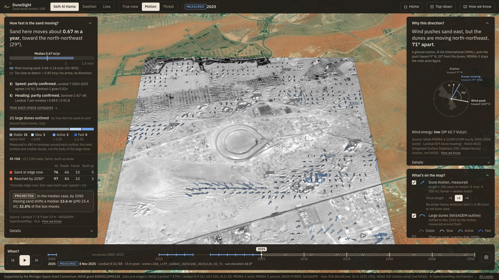
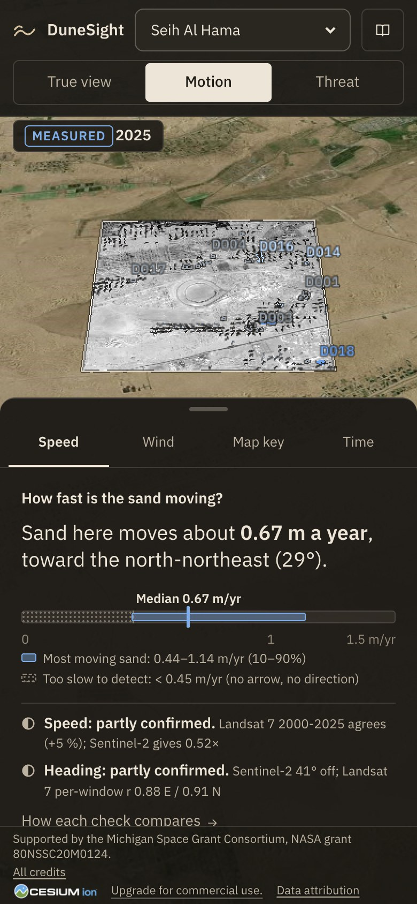

# DuneSight

A "spy satellite for sand dunes": a 3D globe app that shows where dune sand is measurably moving at three UAE sites (Seih Al Hama and Sweihan near Al Ain, and the eastern Liwa crescent), how fast, in which direction and how sure we are, and which roads, farms and built-up areas that moving sand reaches and when. It is built for planners and farm owners deciding where the next windbreak should go.

The measured motion is slow (medians of 0.67 to 1.41 m/yr at the three sites), so the app shows it honestly: a motion-vector field on a stated time scale, "below detection limit" instead of zero, ranges instead of single numbers, a line under each site's speed saying which independent checks confirm it (at Liwa the speed magnitude is not confirmed), and projections clearly labelled as projections. A weather-radar-style timeline plays the observed November Landsat scenes (with the 2002–2012 gap shown as a gap) and then the projected frames to 2050.



**Live:** https://dunesight.us/

## Run the app locally

Needs Node.js (LTS or newer).

```bash
npm install
npm run dev        # http://localhost:5173 (keep this port: the map token only works there)
npm run build      # production build into dist/ (base path from DS_BASE; see Deployment below)
```

Optional: copy `.env.example` to `.env` and set `VITE_CESIUM_TOKEN` to a Cesium ion token. Without a token the globe uses Esri World Imagery and a flat ellipsoid.

**Local development and the map token.** The project's Cesium ion token is accepted only from `https://dunesight.us`, `https://www.dunesight.us` and `http://localhost:5173`. Locally that means port 5173, the Vite default (`vite.config.js` sets it with `strictPort`, so `npm run dev` stops instead of moving to another port when 5173 is taken). Keep `npm run dev` on 5173 to get ion terrain and imagery; on any other port, or from `127.0.0.1`, ion refuses the token and the app runs with the Esri fallback on flat terrain.

**Using it.** Pick a site in the top bar; *True view*, *Motion* and *Threat* are presets of the layers, and every layer (down to each of the five threat classes) has a checkbox in *What's on the map?*. The left panel says how fast the sand moves, with its range, its detection limit and how well an independent check confirms it; the right panel says why it moves that way (wind versus dunes) or, in Threat mode, which roads, farms and built-up areas the sand reaches first. Click an arrow, a dune outline or a target for its card (Esc clears). *When?* plays the measured scenes and then the projected years with the button, the space bar or the arrow keys; its gear holds the reach-year case, the fast-case frame and the changed-pixel overlay. *How we know* opens the method, sources, validation and limits for the site, and reopens the three-step guide shown on the first visit. On a phone the panels become a bottom sheet with tabs. Module-by-module notes and the design choices are in [docs/explain-it.md](docs/explain-it.md).



**Tests.** `npm run test:e2e` builds, then runs the Playwright acceptance suite (spec section 8) against the dev server and against the production build served under its base path, `DS_BASE` (default `/dunesight/`; see below) (first time: `npx playwright install chromium`). `npm run test:e2e:dev` runs only the dev pass. Ports can be moved with `E2E_DEV_PORT`, `E2E_NOTOKEN_PORT` and `E2E_PROD_PORT`. Set `E2E_SWIFTSHADER=1` to force software WebGL.

## Deployment and the base path

Every push to `main` builds the site and deploys it to GitHub Pages (`.github/workflows/deploy.yml`). The production base path, the URL folder the app is served from, comes from one setting, `DS_BASE`. The live site is served at the root of its own domain, so the repository variable `DS_BASE` is set to `/` and the deploy workflow builds with `DS_BASE: /`. When the variable is unset, the code (`scripts/base.mjs`) and the workflow fall back to `/dunesight/`, the GitHub Pages project-site path; this fallback is deliberate, so a fork without the variable still builds and deploys as a project site at `https://<owner>.github.io/dunesight/`. The value must start and end with `/`. Vite's build and `vite preview`, the `postbuild` step (`scripts/postbuild.mjs`, which moves Cesium's static files to `dist/cesium/` when the base is not `/`) and the prod e2e pass (`E2E_TARGET=prod`) all read it, so build and test with the same value, e.g. `DS_BASE=/ npm run build && DS_BASE=/ npm run test:e2e:prod`. `node tests/tools/live.mjs [url]` checks a deployed site (default `https://dunesight.us/`, or set `DS_LIVE_URL`). The dev server always serves at `/`.

The Cesium ion token's allowed-URL list decides where ion terrain and imagery work; the token is accepted only from `https://dunesight.us`, `https://www.dunesight.us` and `http://localhost:5173` (read-only public scopes). From any other origin ion answers 403 and the app falls back to Esri imagery on a flat globe. Run the server under test on port 5173 when checking ion (the dev pass does by default; use e.g. `E2E_PROD_PORT=5173` for the prod pass).

The site moved to its own domain, `dunesight.us`, on 2026-11-15. `https://www.dunesight.us/` and the old project-site address, `https://ssmarzooqi.github.io/dunesight/`, both redirect to `https://dunesight.us/`. The move changed three things together, and any later domain change needs the same three:
1. the repository variable `DS_BASE` (Settings → Secrets and variables → Actions → Variables), now `/`; the workflow falls back to `/dunesight/` while it is unset;
2. the custom domain in Settings → Pages (`dunesight.us`, HTTPS enforced; GitHub serves the site at the domain root), with the domain's DNS pointing at GitHub Pages;
3. the allowed URLs of the Cesium ion token, which must include the new origin.

## Run the pipeline

Needs Python 3.11+ (tested on 3.14).

```bash
python3 -m venv pipeline/.venv
pipeline/.venv/bin/pip install -r pipeline/requirements.txt
npm run placeholders   # write PLACEHOLDER files for every verified site (never overwrites real results)
npm run pipeline       # run notebooks 01 -> 01b -> 02 -> 03 headless for every verified site
```

**Sites.** Site boxes live only in `pipeline/sites.json` (id, name, bbox, EPSG, WRS-2 path/row, `verified`, source note). Each notebook reads its site from the `DUNESIGHT_SITE` environment variable (default `seih_al_hama`); `npm run pipeline` (`pipeline/run_pipeline.py`) loops over the verified sites, and `--site <id>` / `--only 01` narrow it (`--only 01` also matches 01b, the ground-station wind check). Shared code is in `pipeline/dunesight/`.

**Where things go.**
- `public/data/sites.json`: the site list for the app, with each site's status and which of its files are `real` or `placeholder`.
- `public/data/<site_id>/`: the handoff §4 data files for that site (`summary.json`, `dunes.geojson`, `dunes_2000.geojson`, `vectors.geojson`, `targets.geojson`, `wind_summary.json`, `sources.json`, `frames/`), plus `station_wind.json` where notebook 01b publishes a ground-station comparison (Seih Al Hama only).
- `pipeline/runs/<site_id>/`: executed copies of the notebooks, with outputs, as documentation. The source notebooks in `pipeline/` are kept without outputs.
- `pipeline/outputs/<site_id>/`: small working outputs (candidate-scene tables, rejection logs, the proposed scene list, wind tables, figures).
- `pipeline/raw/<site_id>/`: downloads and caches (ignored by git). Set `DUNESIGHT_REFRESH=1` to re-query instead of using the cache.

Earth Engine (`EE_PROJECT`) and NASA Earthdata (`EARTHDATA_USERNAME`, `EARTHDATA_PASSWORD`) credentials go in `.env`, which is never committed.

## NASA datasets

- Landsat 7 ETM+ and Landsat 8/9 OLI Collection 2 Level-1, panchromatic band B8 (15 m): dune motion
- Harmonized Landsat Sentinel-2 (HLSL30 / HLSS30) v2.0 (30 m): independent second-dataset check
- MERRA-2 hourly 10 m wind (U10M, V10M), with NASA POWER as a cross-check: sand drift potential
- NASADEM (30 m, February 2000): dune outlines and heights

Full citations (versions, dates, places, pixel sizes, DOIs) are in [docs/data-and-credits.md](docs/data-and-credits.md); what the numbers mean, their limits and how each site's speed is cross-checked are in [docs/how-we-know.md](docs/how-we-know.md). Also used: NOAA ISD station wind (Seih Al Hama check only), ESA WorldCover, OpenStreetMap (roads and built-up areas, © OpenStreetMap contributors) and Esri / Cesium basemaps for display.

## Credits

Supported by the Michigan Space Grant Consortium, NASA grant 80NSSC20M0124.

Data and imagery courtesy of NASA and USGS (datasets listed above); station wind data from NOAA NCEI. Typeface: IBM Plex, SIL Open Font License 1.1, bundled with the app. This project is not endorsed by NASA.

## License

MIT, see [LICENSE](LICENSE).
